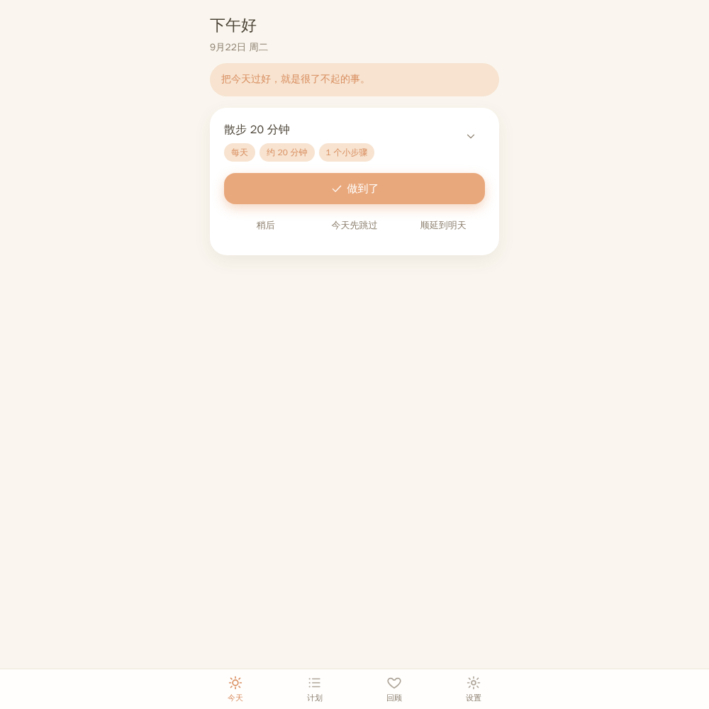

# 拾光记


> 一个住在手机里的温柔计划本：记住你想做的事，但不逼你完成。
> 计划是选项，不是命令。

拾光记是一款面向手机端的计划类 PWA 应用。适合想规划长期目标和短期任务、但不喜欢被催、被打卡、被惩罚的人。完成很好，不完成也不会被责备。

- **离线优先**：所有数据只存在本机，无账号、无登录、不上传服务器。
- **开源协议**：本项目以 [MIT 许可证](LICENSE) 发布，可自由学习、修改与二次分发。



## 核心设计原则

1. **不强制完成**：没有逾期、失败、未完成、落后、断签、扣分、惩罚。
2. **不强烈催收**：通知默认关闭，不出现红点轰炸，不自动发催收提醒。
3. **不制造焦虑**：不显示“你落后了”“今日必须完成”等压迫文案。
4. **允许弹性**：计划可顺延、跳过、暂停、归档、补记完成。
5. **鼓励但不绑架**：完成时给温柔反馈和随机激励语录（内置 24 条名人名言，可在「语录集」里增删改）。
6. **界面简洁温馨**：奶油白/浅米色背景、浅杏/暖黄/柔绿主题色、大圆角、柔和阴影、200-300ms 微动效、可切换深色模式。

## 功能

- **今日页**：问候语 + 日期 + 每日一句（**点击即可换一句**，旁边书签进入「语录集」）；展示“今天可以选择做”的卡片，可**做到了 / 稍后 / 今天先跳过 / 顺延到明天**，完成后播放柔和微动效并出现随机语录；底部新增**明天的打算**——随手记一件明天的小事，第二天自动出现在今日卡片里；正在靠近的长期目标以温柔胶囊展示。
- **计划页**：长期计划（目标、为什么、期望周期、阶段/里程碑、关联短期行动）+ 短期计划（任务或习惯、日期、重复规则、预计时长、子步骤、备注）；支持编辑、暂停、归档、删除、补记完成。
- **记录页**：**日记 = 收录集**——可写文字 + 贴多张图片（相册/拍照/粘贴），列表显示缩略图，点开具体日期可看大图、继续编辑文字（自动保存）；**灵感集**——随手记下的想法。
- **语录集**（新增）：今日页书签进入。内置 24 条温柔鼓励向名人名言（木心、龙应台、圣埃克苏佩里、海子、顾城、毛姆、村上春树、尼采、中岛美嘉、泰戈尔、宫崎骏等，不含中国古代诗词），按「今天 / 完成 / 顺延 / 跳过 / 回顾」分组随机出现；可**添加 / 修改 / 删除**，整个语录池本地持久化，删掉的句子不会再回来。
- **回顾页**：温柔统计——“这周你为自己做了 N 次选择”“这个月你靠近了 N 个目标”，本周每日记录的小柱图、正在靠近的目标；**完成收录集**——每完成一件小事（或长期计划完成/归档）都会自动收进回顾页，完成时今日页会温柔地问一句要不要去补记录；每条可**补一段文字或贴几张照片**（改动自动保存，可删记录）。不显示完成率、失败次数、中断天数。
- **设置页**：提醒通知（默认关闭；开启后可选每天一条的本地提醒时间，仅 App 内生效）、每日一句开关、主题色（浅杏/暖黄/柔绿）、外观（浅色/深色/跟随系统）、JSON 导出/导入、清空数据、关于（**关于区显示「你在这里写下了 N 个字」**——统计计划、日记、灵感、完成收录里你亲手写下的所有文字，温柔见证，只增不减）。导出后**弹窗明确提示文件名与保存位置**：App 内写入设备「文档」目录（公共目录不可写时自动降级到应用内部存储），网页版下载到浏览器默认下载文件夹。

## 技术栈

| 层 | 技术 | 说明 |
| --- | --- | --- |
| 框架 | React 18 + Vite 5 + TypeScript | 严格模式，组件化 |
| 样式 | Tailwind CSS 3 + CSS 变量主题令牌 | 主题色/深浅模式通过 `data-*` 属性切换 |
| 路由 | react-router-dom（HashRouter） | 静态托管和 Capacitor 都兼容 |
| 状态 | React Context + Repository 模式 | UI 与业务逻辑分离 |
| 存储 | localStorage（StorageAdapter 抽象）+ IndexedDB（日记图片） | 离线优先，未来可换 SQLite/云同步 |
| 通知 | NotificationAdapter 抽象 + @capacitor/local-notifications | 网页版不发送；App 内每天至多一条本地提醒 |
| PWA | vite-plugin-pwa | manifest + Service Worker，可添加到主屏幕、离线可用 |
| 原生打包 | Capacitor | `capacitor.config.ts` + npm 脚本已配好 |

## 项目结构

```
shiguangji/
├── public/icons/          # PWA 图标（192/512/maskable/apple-touch/favicon）
├── docs/screenshots/      # 界面预览截图
├── src/
│   ├── types/models.ts    # 数据模型（稳定层，导出/导入依赖它）
│   ├── data/quotes.ts     # 内置语录池（24 条名人名言，分场景）
│   ├── storage/           # 存储适配器（localStorage + IndexedDB 图片存储）
│   ├── repositories/      # 仓库：计划 + 设置 + 日记 + 语录集 + 完成收录集
│   ├── services/          # 通知适配器（Web 空实现 / Capacitor 本地通知）
│   ├── context/           # App 状态与业务操作
│   ├── utils/             # 日期 / id / 图片压缩 / 导入导出工具
│   ├── components/        # UI 组件（卡片、表单、弹窗、导航、日记/收录详情…）
│   └── pages/             # 今日 / 计划 / 记录 / 回顾 / 设置
├── vite.config.ts         # PWA 配置（manifest + workbox）
├── capacitor.config.ts    # Capacitor 预留配置
└── package.json           # 含打包脚本
```

## 快速开始（在你的电脑上）

需要 Node.js 18+（推荐 20+）。不需要任何其他环境。

```bash
# 1. 进入项目
cd shiguangji

# 2. 安装依赖（首次约几分钟）
npm install

# 3. 启动开发服务器
npm run dev
# 浏览器打开 http://localhost:5173 即可使用

# 4. 构建生产版本（产物在 dist/）
npm run build

# 5. 本地预览生产版本
npm run preview
```

## 在手机上使用（PWA 添加到主屏幕）

拾光记是 PWA：**先在电脑上部署到公网（或局域网），再用手机浏览器打开链接，即可“添加到主屏幕”，像 App 一样全屏使用、可离线打开。**

### 方案 A：临时在局域网里体验（最快）

1. 电脑和手机连接同一个 Wi-Fi。
2. 电脑上运行 `npm run dev`，终端会显示局域网地址，例如 `http://192.168.x.x:5173/`。
3. 手机浏览器打开这个地址即可使用。
4. 注意：这种方式**不能**安装到主屏幕（Service Worker 需要 HTTPS 或 localhost）。

### 方案 B：部署到公网（推荐，可安装到主屏幕）

任选一个免费托管平台，把 `dist/`（构建后的静态文件）部署上去即可：

**Vercel（最简单）**
```bash
npm i -g vercel
npm run build
cd dist && vercel --prod
```
部署完成后会得到一个 `https://xxx.vercel.app` 链接。

**Netlify**
```bash
npm run build
npx netlify-cli deploy --prod --dir=dist
```

**GitHub Pages**
1. 把项目推到 GitHub 仓库。
2. 设置 → Pages → 部署分支/目录选择 `dist`（或用 Actions 构建）。

> PWA 安装的前提：**HTTPS**（`localhost` 除外）。Vercel / Netlify 自带 HTTPS，GitHub Pages 也支持。

### 添加到主屏幕

**iPhone（Safari）**
1. 用 Safari 打开你的拾光记链接。
2. 点底部工具栏的「分享」按钮（方框箭头图标）。
3. 选择「添加到主屏幕」→ 确认名称「拾光记」→ 点「添加」。
4. 桌面出现拾光记图标，点开即全屏运行。

**Android（Chrome）**
1. 用 Chrome 打开链接。
2. 点右上角「⋮」菜单 →「添加到主屏幕」（或「安装应用」）。
3. 确认后桌面出现图标。

安装后：底部导航、离线打开、数据都存在本机浏览器里，与网页版完全一致。

## 打包成 iOS / Android App（Capacitor，无需重写代码）

项目已预留 Capacitor 配置（`capacitor.config.ts`）和 npm 脚本。核心业务代码完全复用，不重写。

### 前置条件

- Node.js 18+
- **Android**：安装 [Android Studio](https://developer.android.com/studio)（含 Android SDK）
- **iOS**：需要 macOS + Xcode（只能在你自己的 Mac 上执行 iOS 打包）

### 步骤

```bash
# 1. 安装依赖（如未安装）
npm install

# 2. 生成原生工程（首次执行一次）
npx cap add android     # 生成 android/ 目录
npx cap add ios         # 生成 ios/ 目录（仅 macOS）

# 3. 以后每次改完代码，重新构建并同步
npm run build
npx cap sync

# 4. 打开原生工程
npx cap open android    # 打开 Android Studio
npx cap open ios        # 打开 Xcode（仅 macOS）

# 5. 在 IDE 里运行 / 打包
#   Android：点 Run 直接安装到手机；Build → Generate Signed Bundle 生成上架包
#   iOS：选好签名证书后 Run；Product → Archive 生成上架包
```

常用脚本也写在 `package.json` 里：

```bash
npm run cap:add:android
npm run cap:add:ios
npm run cap:sync
npm run cap:open:android
npm run cap:open:ios
```

打包说明：
- App 名称：拾光记；包名：`com.youplan.app`（可在 `capacitor.config.ts` 修改）。
- 提醒通知：`src/services/notifications.ts` 已接入 Capacitor Local Notifications——网页版不发送任何通知；打包成 App 后，在设置里开启即可收到每天一条的温和本地提醒（可自选时间）。
- 上架 App Store / Google Play 需要开发者账号（¥/年），与代码无关。

## 后续可以改什么

| 想改什么 | 在哪里改 |
| --- | --- |
| 应用名 / 包名 | `capacitor.config.ts`、`vite.config.ts` 的 manifest、`index.html` 标题 |
| 内置语录 | `src/data/quotes.ts`（24 条，按场景：今天/完成/顺延/跳过/回顾）；运行时可在 App 内「语录集」直接增删改 |
| 主题色 | `src/index.css` 的 `:root` 变量 + `src/pages/SettingsPage.tsx` 的 ACCENTS |
| 文案 | 各页面组件里的中文文案，全局搜一下即可 |
| 日记图片上限/压缩质量 | `src/utils/image.ts`（MAX_DIM / QUALITY） |
| 提醒时间 / 文案 | `src/pages/SettingsPage.tsx` 与 `src/context/AppContext.tsx` 的通知逻辑 |
| 数据模型 | `src/types/models.ts`（改后需同步导出/导入校验） |
| 存储方式 | 新增一个实现 `StorageAdapter` 的类，替换 `LocalStorageAdapter` |
| 云同步 / 账号 | 在 repository 层接后端即可，UI 无需大改 |
| 图标 | 替换 `public/icons/` 下的 PNG/SVG，重新 `npm run build` |

## 数据与隐私

- 所有数据只保存在**本机**（浏览器 localStorage/IndexedDB 或打包后 App 的本地存储），**不上传任何服务器**，无账号、无登录。
- 换设备/清缓存前，建议在「设置 → 导出 JSON」备份；换好设备后「导入 JSON」恢复。App 内导出会保存到设备「文档」目录并弹窗显示完整路径；网页版导出到浏览器默认下载文件夹。
- 导出文件是一个 JSON，包含所有计划、完成记录、**完成收录集的文字与元数据**、日记文字与灵感、设置与语录集；**图片本体不入备份**（体积大，留在本机），未来做云同步时再带上。

## 如何发布新版本（检查更新，可选）

> **开源版默认关闭自动更新检查**：`src/services/updateChecker.ts` 里的 `UPDATE_MANIFEST_URL` 留空，App 不会联网检查更新。下面这套机制是可选的，只有你自己发布打包版、并想让旧用户收到更新提醒时才需要配置。

拾光记内置「检查更新」：配置清单地址后，打开 App 每天自动检查一次（网络不通则安静跳过），发现新版本会轻轻提醒；也可以在「设置 → 检查更新」手动查看。弹窗可勾选「不再提醒这个版本」。

更新清单地址写在 `src/services/updateChecker.ts` 的 `UPDATE_MANIFEST_URL`。发布新版本的步骤：

1. 改完代码后更新版本号：`package.json`、`src/utils/exportImport.ts` 的 `APP_VERSION`，以及 **`android/app/build.gradle` 的 `versionCode`（每次 +1）与 `versionName`**（写成 vX.Y.Z）。这三处不同步，Android 会一直认为是"相同版本"、拒绝更新提示。
2. `npm run build` 后按上方流程打包出 `shiguangji-vX.Y.Z.apk`。
3. 把新版 APK 上传到更新仓库 `youplan-updates`（GitHub），文件名带版本号。
4. 修改仓库根目录的 `update.json`：

```json
{
  "latest": "0.5.0",
  "notes": [
    "回顾页新增「完成收录集」，完成的事都收在这里",
    "每件事都可以补文字和照片，留一份自己的记录"
  ],
  "apkUrl": "https://cdn.jsdelivr.net/gh/<你的GitHub用户名>/youplan-updates@main/shiguangji-v0.5.0.apk",
  "publishedAt": "2026-10-17"
}
```

5. 等一两分钟（jsDelivr CDN 刷新），所有已装 App 的用户打开 App 就会收到更新提醒，点「去更新」即可**在 App 内下载**（不跳浏览器；下载进度看系统通知栏，完成后点通知安装）。

说明：Android 系统要求用户手动确认安装 APK（首次需允许"安装未知来源"），这是安全限制，任何 App 都无法绕过。之后想真正"无感自动更新"，需要上架应用商店（商店统一管理更新）。

## 常见问题

**Q：为什么手机上打开没有“添加到主屏幕”选项？**
A：PWA 安装需要 HTTPS（或 localhost）。局域网 IP 访问不支持安装，请先部署到 Vercel/Netlify 等带 HTTPS 的平台。

**Q：数据会丢吗？**
A：正常使用不会丢。但清除浏览器数据、卸载浏览器或换设备会清空，建议定期导出 JSON 备份。

**Q：通知打开有用吗？**
A：网页版不发送任何通知（保持不打扰）。打包成 App 后，在设置里开启即可收到每天一条温和的本地提醒，可自选时间。

**Q：日记里的图片存在哪里？会占很多空间吗？**
A：图片只存在 App 本地（IndexedDB），不联网。选图时会自动压缩到合适大小，一般一张几十 KB 到几百 KB，不会占用太多空间。

**Q：我改坏了代码怎么办？**
A：整个项目都在 `shiguangji/` 目录里，用 Git 管理（`git init` 后每次改动 `git commit`），改坏了可以回退。

## 版本

v0.5.4：修复"每次更新都提示相同版本"——安卓工程版本号长期停在 1.0 未更新，现已改为与 App 版本同步（versionCode 递增）；更新下载改为 **App 内下载**，不再跳转浏览器（下载进度看通知栏，完成后点通知安装）。
v0.5.3：新增温柔语录（J.K.罗琳《哈佛演讲》，回顾场景）；内置语录支持**增量合并**——老用户装新版也能看到新增内置句，且已删除的句子不会复活。
v0.5.2：修复更新检查偶发拿到旧清单（检查更新时强制绕过缓存，每次真实回源）。
v0.5.1：设置页「关于」新增「累计写字数」——统计计划、日记、灵感、完成收录里你亲手写下的所有文字，温柔见证、只增不减（语录池为内置与自增混存，不纳入统计）。
v0.5.0：新增「检查更新」——打开 App 每天自动检查新版本（发现后温柔提醒、可勾选不再提醒该版本）；设置页新增「检查更新」按钮（已是最新时显示安心提示）；更新包托管说明见「如何发布新版本」→ 打包交付 APK。
v0.4.1：修复归档收录——短期计划归档也会收进完成收录集（带「归档」徽章）；已归档但未收录的历史计划会自动补录 → 打包交付 APK。
v0.4.0：完成收录集上线——完成的短期计划与长期计划（完成/归档）自动收进回顾页；完成时今日页弹出温柔引导（可暂不/去记录）；每条收录可补文字 + 贴照片（自动保存、可删除）；导出/导入含完成收录 → 打包交付 APK。
v0.3.0：语录集上线——今日页书签改为进入语录集；内置 24 条温柔鼓励向名人名言（去除旧 34 条自写语录、不含中国古代诗词），支持添加/修改/删除、本地持久化；移除记录页「收藏的句子」区块 → 打包交付 APK。
v0.2.0：新增记录页（日记收录集 + 贴图 + 灵感集）、明日计划、语录点击换句与收藏、设置页通知方案 B（App 内本地提醒）→ 打包交付 APK。
v0.1.0（MVP）：新建计划 → 今日页展示 → 做到了/顺延/跳过 → 激励语录 → 回顾页 → 设置页 → 本地存储 → PWA 安装 → Capacitor 打包预留。
